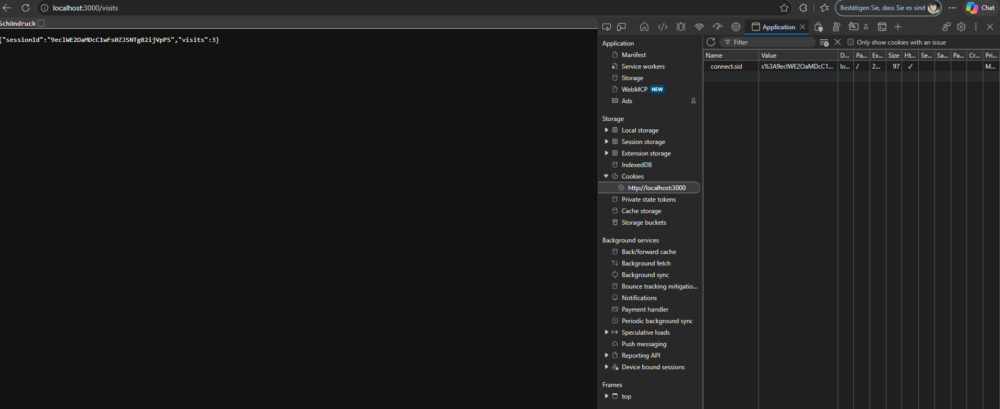

# Antworten: express-session

## Ausgaben der curl-Aufrufe

Die Sitzungs-IDs und signierten Cookie-Werte sind hier aus der Ausgabe gekürzt.

### 1. Ohne Cookie-Speicher

```text
$ curl -i http://localhost:3000/visits
HTTP/1.1 200 OK
X-Powered-By: Express
Content-Type: application/json; charset=utf-8
Content-Length: 59
ETag: W/"3b-lNwsXA/3gHkl6LJFL4+iUm31zMI"
Set-Cookie: connect.sid=s%3AcE5BlVP6PkP7ESiLehXkV1kw2MrTYBX_.858%2F3downqiwgXxK%2FkDu6p0MdoHCroL5XnQr1aqkfHc; Path=/; Expires=Sun, 15 Nov 2026 09:49:37 GMT; HttpOnly
Date: Sun, 15 Nov 2026 09:19:37 GMT
Connection: keep-alive
Keep-Alive: timeout=5

{"sessionId":"cE5BlVP6PkP7ESiLehXkV1kw2MrTYBX_","visits":1}
```

Der Server erstellt eine Sitzung und sendet ein Cookie zurück. 
Da curl das Cookie nicht speichert und bei der nächsten Anfrage nicht mitsendet, kann die nächste Anfrage diese Sitzung nicht wiederverwenden. Der Zähler beginnt dann erneut bei `1`.

### 2. Mit Cookie-Speicher

```text
$ curl -i -c cookies.txt -b cookies.txt http://localhost:3000/visits
HTTP/1.1 200 OK
X-Powered-By: Express
Content-Type: application/json; charset=utf-8
Content-Length: 59
ETag: W/"3b-6GueX6IeNzHFhnIGuGEcKhuIdPc"
Set-Cookie: connect.sid=s%3AW2w5P9RsmeiTxI-Fe9zekMAr_jr6XkDu.mllSoQwOjxVE1YkdP%2FvmWkRZMh2v5OjnPODS746EKmE; Path=/; Expires=Sun, 15 Nov 2026 09:50:35 GMT; HttpOnly
Date: Sun, 15 Nov 2026 09:20:35 GMT
Connection: keep-alive
Keep-Alive: timeout=5

{"sessionId":"W2w5P9RsmeiTxI-Fe9zekMAr_jr6XkDu","visits":1}
```

`-c cookies.txt` speichert das empfangene Cookie. In diesem ersten Aufruf mit Cookie-Speicher existiert noch keine Sitzung im Cookie-Speicher; daher wird eine neue Sitzung angelegt und der Zähler ist `1`.

### 3. Erneut mit demselben Cookie-Speicher

```text
$ curl -i -c cookies.txt -b cookies.txt http://localhost:3000/visits
HTTP/1.1 200 OK
X-Powered-By: Express
Content-Type: application/json; charset=utf-8
Content-Length: 59
ETag: W/"3b-SJlrjW335xDutbvAp+6tQfX2eNo"
Set-Cookie: connect.sid=s%3AW2w5P9RsmeiTxI-Fe9zekMAr_jr6XkDu.mllSoQwOjxVE1YkdP%2FvmWkRZMh2v5OjnPODS746EKmE; Path=/; Expires=Sun, 15 Nov 2026 09:50:54 GMT; HttpOnly
Date: Sun, 15 Nov 2026 09:20:54 GMT
Connection: keep-alive
Keep-Alive: timeout=5

{"sessionId":"W2w5P9RsmeiTxI-Fe9zekMAr_jr6XkDu","visits":2}
```

`-b cookies.txt` sendet das gespeicherte Cookie zurück. Der Server findet damit dieselbe Sitzung und erhöht den Zähler von `1` auf `2`. Da die Sitzung bei der Antwort aktualisiert wird, wird auch die Ablaufzeit erneuert.

## Cookie `connect.sid` in den Browser-Entwicklertools

Nach mehreren Aufrufen von `http://localhost:3000/visits` wurde in Edge unter **DevTools → Application → Cookies → http://localhost:3000** das Cookie `connect.sid` angezeigt. Die Werte der Attribute waren:

| Attribut | Wert |
|---|---|
| HttpOnly | Ja |
| Expires / Max-Age | Läuft etwa 30 Minuten nach dem Setzen ab (`Expires`); kein `Max-Age`-Attribut |
| Secure | Nein (nicht gesetzt) |
| SameSite | Nicht gesetzt |

Der DevTools-Screenshot wurde während dieser Sitzung aufgenommen:



## Session-Speicher

`express-session` speichert Sitzungsdaten standardmäßig im `MemoryStore`, also im Arbeitsspeicher des Node.js-Prozesses. Dieser Speicher ist laut Dokumentation nicht für den Produktivbetrieb gedacht: Er kann unter typischer Last Speicher verlieren (Memory Leak), wird nicht zwischen mehreren Prozessen geteilt und Sessions gehen beim Neustart des Prozesses verloren. Er eignet sich daher nur für Entwicklung und Debugging.

Zwei Alternativen für persistente Session-Stores:

1. **connect-mongo** – speichert Sessions in MongoDB.
2. **connect-redis** – speichert Sessions in Redis.
